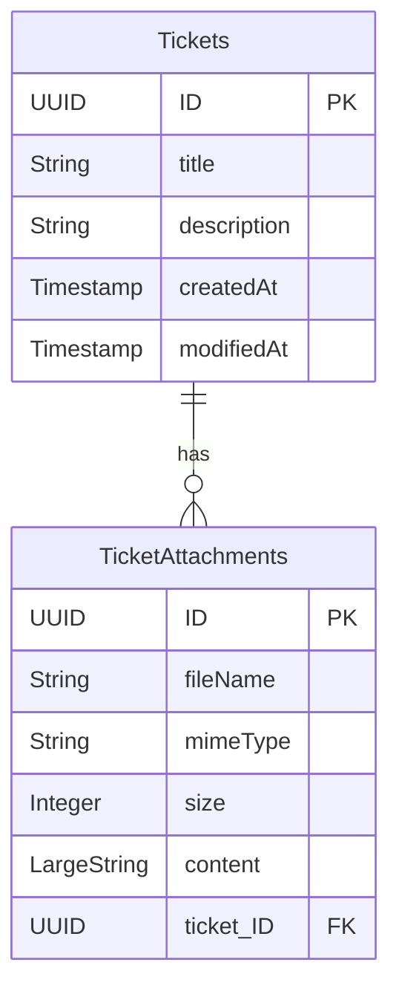

# Entities

Defined in `db/schema.cds`, namespace `com.example.tickets`.

- Both entities use `cuid` and `managed` aspects from `@sap/cds/common`.
- `Tickets.attachments` is a `Composition of many TicketAttachments` with the
  backlink `on attachments.ticket = $self`.
- `TicketAttachments.content` is a **LargeString holding base64** — the
  column is always null in the database; the value lives in the object store
  keyed by the attachment's `ID` (see [backend/ticket-service.md](backend/ticket-service.md)).
- The `TicketAttachments` projection must be exposed in the service — CAP
  drops compositions whose target is not part of the service model.
