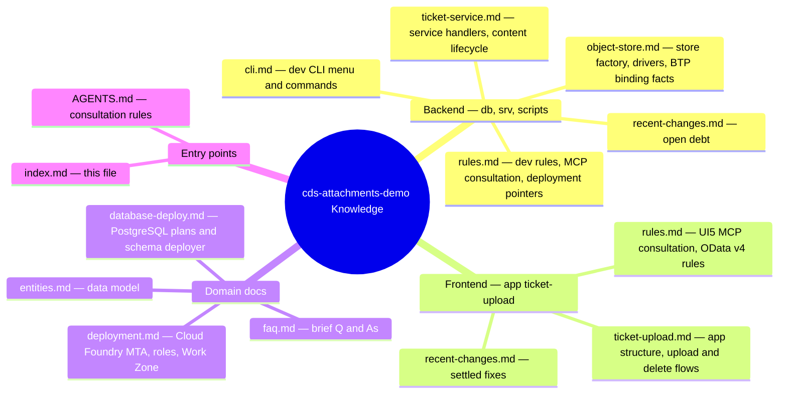
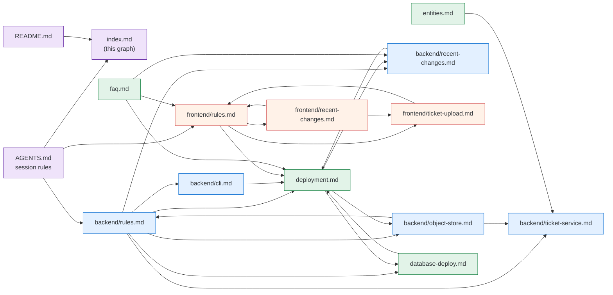

# Project Knowledge Index

Minimal SAP CAP template: one service, one entity — attachments implemented by hand (no attachment plugin) on top of a provider-agnostic object store, with a one-page UI5 upload app and a Cloud Foundry MTA. AGENTS.md defines when consultation of the knowledge files is mandatory. The mindmap below shows the knowledge structure at a glance; the flowchart below it maps the cross-references between the files.

## Knowledge Graph (cross-references)

An arrow means *"document A references document B"*; every edge was extracted from the actual cross-references in the files.

## Knowledge Files

| Component | File | Read before working on |
|-----------|------|------------------------|
| Backend rules | `backend/rules.md` | Any file in `db/`, `srv/`, `scripts/` |
| TicketService | `backend/ticket-service.md` | Any task touching `srv/ticket-service.cds` or the handlers in `srv/ticket-service.ts` |
| Object store | `backend/object-store.md` | Any task touching `srv/store/`, `srv/util/env.ts` or the objectstore binding |
| Dev CLI | `backend/cli.md` | Any task touching `scripts/` or the interactive menu commands |
| Backend recent changes | `backend/recent-changes.md` | Backend work context (open debt) |
| Frontend rules | `frontend/rules.md` | Any file in `app/ticket-upload/webapp/` |
| UI app | `frontend/ticket-upload.md` | Any task touching the views, controllers, i18n or manifest of `app/ticket-upload` |
| Frontend recent changes | `frontend/recent-changes.md` | Frontend work context (settled fixes) |
| Domain model | `entities.md` | Entities and their properties/associations |
| Deployment | `deployment.md` | Any deployment, mta.yaml, .deploy/, binding or production task |
| Database | `database-deploy.md` | Any task changing the PostgreSQL plan, options or schema deployment |
| FAQ | `faq.md` | Quick lookups |
